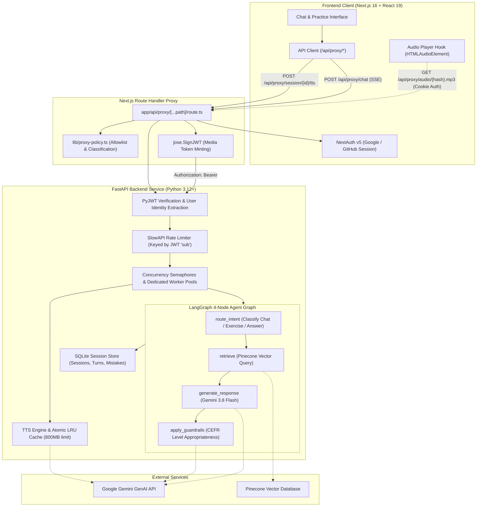
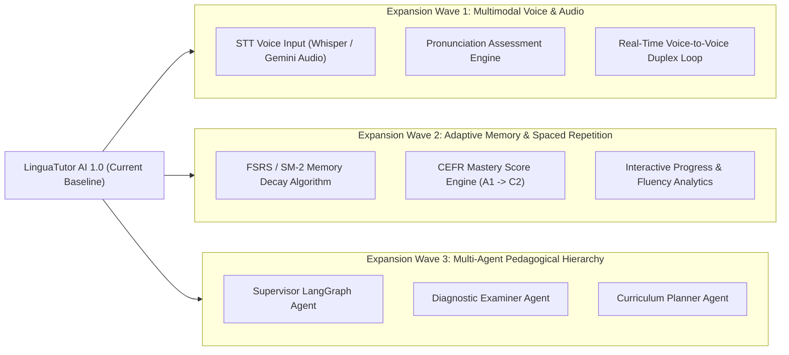
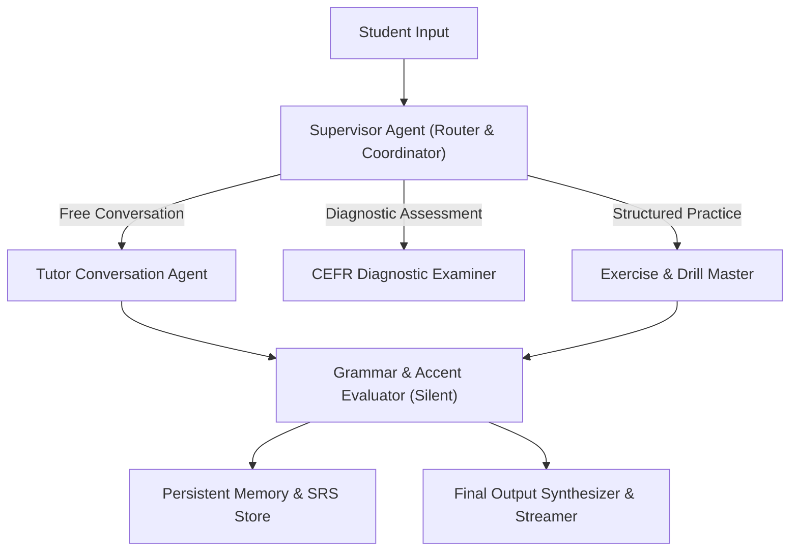

# Language Tutor Assistant: Complete Architectural Specification & Future Expansion Blueprint

> **System Name**: LinguaTutor AI (Autonomous Trilingual Language Tutor & Knowledge Engine)  
> **Status**: Core Full-Stack Production Baseline Completed & Audited (Phases 1–4)  
> **Version**: `1.0.0-prod`  
> **Target Roles**: AI Agent Engineer, Senior Full-Stack Engineer, Enterprise Applied AI

---

## 1. System Vision & Problem Statement

Language learners struggle to bridge the gap between passive grammar study and active conversational fluency. Traditional apps (Duolingo) rely on rigid scripted multiple-choice drills, while vanilla LLM chats (ChatGPT) lack structured pedagogical scaffolding, systematic mistake tracking, level-appropriate guardrails, and deterministic curriculum feedback.

**LinguaTutor AI** solves this by combining:
1. **Adaptive Pedagogical Agent Graphs**: Multi-node LangGraph agent enforcing level-appropriate grammar, silent tool usage, and CEFR boundary guardrails.
2. **Context-Aware Retrieval (RAG)**: Pinecone vector search over native grammar rules and curated vocabulary sets.
3. **Continuous Mistake Memory**: Persistent tracking of student weaknesses across sessions with targeted review exercises.
4. **Safe Streaming UX**: Full reply generated, then streamed with a typing effect using Server-Sent Events (SSE) with post-processing guardrail verification and turn persistence before stream emission.
5. **Secure Audio Synthesis**: Gemini 3.8 Flash TTS with bounded LRU disk caching and authenticated browser proxying.

---

## 2. Full-Stack System Architecture

### 2.1 Topology Diagram



---

## 3. Current Implementation Specification (Phases 1–4)

### 3.1 Backend Engineering Baseline (`04-language-tutor/backend`)

| Component | Technology | Production Implementation Details |
| :--- | :--- | :--- |
| **Runtime & Framework** | Python 3.12, FastAPI, Uvicorn | Single-process, single-replica architecture by design (1 worker, no `--workers N`). In-process per-session turn serialization locks (`_session_locks`), worker pools (`_llm_executor`, `_tts_executor`), semaphores (`LLM_CONCURRENCY=8`, `TTS_CONCURRENCY=8`), rate limiting, background-turn tracking, and SQLite WAL mode require a single process to prevent lost updates; multi-replica scaling is deferred to PostgreSQL (Expansion 5). |
| **Orchestration Graph** | LangGraph 1.2+ (`CompiledStateGraph`) | 4-node pipeline: `route_intent` → `retrieve` → `generate_response` → `apply_guardrails`. `route_intent` supports language-independent hint requests (`hint_request: bool` and multilingual hint keywords in English, Korean, and Japanese) to converse naturally without grading hints as answers. |
| **Token Streaming** | Server-Sent Events (SSE) | Executes LangGraph pipeline in a shielded background task (`_run_and_save_turn`) so client disconnects during the 5–50s graph run or streaming never lose the turn. Enforces guardrails, grade normalization, and atomic SQLite persistence before streaming cleaned tokens with a typing effect. |
| **Rate Limiting** | SlowAPI | Keyed by JWT `sub` via `_rate_limit_key` (with IP fallback) to prevent noisy neighbor starvation across shared proxy connections. |
| **Audio Engine** | Google Gemini 3.8 Flash TTS | Bounded 800 MB LRU disk cache with 80% watermark eviction, atomic `.tmp.<uuid>` file swaps, libmp3lame transcoding via ffmpeg, and ref-counted thread locks. |
| **Context Windowing** | History slicing | Active turn history replayed into Gemini is capped to `MAX_REPLAY_TURNS = 20`, bounding LLM context cost to $O(1)$ while SQLite retains full transcripts. |
| **Packaging** | PEP 621 `pyproject.toml`, Dockerfile | Pinned `requirements.lock`, system `ffmpeg` for transcoding, container health check on `/health`. |

### 3.2 Frontend Engineering Baseline (`04-language-tutor/frontend`)

| Component | Technology | Production Implementation Details |
| :--- | :--- | :--- |
| **Framework & UI** | Next.js 16 (`16.2.6`), React 19, Tailwind v4 | Modular hook architecture (`use-chat-workflow.ts`, `use-audio-player.ts`, `use-session-list.ts`). |
| **Authentication** | NextAuth v5 (`5.0.0-beta.31`) | OAuth providers (Google, GitHub), session cookies, HTTP-only storage. |
| **API Proxy Gateway** | `app/api/proxy/[...path]/route.ts` | Path allowlist (`lib/proxy-policy.ts`), NextAuth session validation, 120s timeout budget, unbuffered SSE passthrough. |
| **Media JWT Minting** | `jose.SignJWT` (v6) | Mints short-lived (1h) backend JWTs for native `<audio src="...">` elements that cannot attach HTTP headers. |
| **Interactive Panels** | Exercise Panel & Mistakes Drawer | Dedicated Practice Mode Drawer with localized hint requests (`hint_request: true`), answer evaluation, and persistent mistake log viewer. |
| **Multi-Tab Safety** | `useMultiTabDetector` | BroadcastChannel heartbeat with tab election persistence (`electedRef.current`) and non-destructive overlay mounting. |
| **Security & Routing** | CSP & Route Boundaries | Strict Content Security Policy in `next.config.mjs` with `'unsafe-eval'` excluded in production (active only in development), route-level `app/error.tsx`, and `app/not-found.tsx`. |

---

## 4. Architectural Analysis: Why the Project Currently Feels "A Bit Too Simplified"

While the project has achieved production-grade hardening, reliability, and low-latency streaming, its **functional domain depth** remains intentionally scoped to MVP levels. 

Here is an objective breakdown of current domain simplifications:

1. **Linear Graph vs. Autonomous Agency**:
   - *Current*: The LangGraph pipeline runs linearly: `route_intent` → `retrieve` → `generate_response` → `apply_guardrails`.
   - *Limitation*: The agent cannot autonomously decide to ask clarifying questions, branch into multi-step diagnostic assessments, or inspect external learning resources on its own.
2. **Single-Turn Exercise Flow**:
   - *Current*: When a user requests an exercise, the agent outputs a single prompt. When the user responds, it grades and resets `last_exercise`.
   - *Limitation*: No concept of a structured 5-question lesson, progressive difficulty ramp-up, or adaptive scoring based on immediate performance.
3. **One-Way Audio (Text-to-Speech Only)**:
   - *Current*: The user types text; the tutor can speak text back via TTS.
   - *Limitation*: Real language fluency requires spoken practice. There is currently no Speech-to-Text (STT), voice recording, or phoneme-level pronunciation grading.
4. **Static RAG without Personal Knowledge Ingestion**:
   - *Current*: Pinecone holds a fixed set of static grammar and vocab notes.
   - *Limitation*: The student cannot upload custom study materials (e.g. a PDF textbook chapter or syllabus) to generate personalized study decks.
5. **Basic Mistakes Log vs. Spaced Repetition (SRS)**:
   - *Current*: Mistakes are stored in a simple append-only list (`mistake_log`).
   - *Limitation*: No temporal decay, forgetting curve modeling (Leitner or SuperMemo SM-2 / FSRS), or scheduled review intervals.

---

## 5. Master Expansion Blueprint: High-Signal Feature Extensions

Below is the concrete roadmap for expanding LinguaTutor AI from an MVP into an enterprise-grade AI language platform.



---

### Expansion 1: Full Voice-to-Voice Multimodal Loop & Pronunciation Grading

#### 1. The Architectural Vision
Transform the app from a typing interface into a true oral conversational partner. The student speaks into their microphone; the system transcribes their speech, diagnoses pronunciation accuracy, and responds with audio.

#### 2. Implementation Specifications
1. **Frontend Audio Capture**:
   - Use `navigator.mediaDevices.getUserMedia` with `MediaRecorder` (recording to `audio/webm;codecs=opus`).
   - Provide an animated visualizer (HTML5 Canvas or Web Audio `AnalyserNode`) showing live microphone audio waves.
   - Push audio chunks to `/api/proxy/session/{id}/voice-turn` or over a WebSocket connection.
2. **Backend Audio Transcription (STT)**:
   - Endpoint: `POST /session/{id}/voice-turn` accepting binary audio payload.
   - Integration: **OpenAI Whisper** (via `whisper-large-v3` / Groq API for <200ms transcription) or **Google Gemini Multimodal Audio**.
3. **Pronunciation Assessment Engine**:
   - Compare student transcript against expected phonetic targets using Levenshtein word distance and phonetic matching (Metaphone / Double Metaphone).
   - Return word-level pronunciation highlights:
     - 🟢 Green: Fluent / accurate phonemes.
     - 🟡 Yellow: Minor accent / cadence hesitation.
     - 🔴 Red: Mispronounced phoneme with corrective phonetic spelling (e.g., *"/ˈkɑː.fild/"*).

---

### Expansion 2: Spaced Repetition System (SRS) & Adaptive Knowledge Graph

#### 1. The Architectural Vision
Turn the simple `mistake_log` into a mathematically rigorous memory engine based on the **Free Spaced Repetition Scheduler (FSRS)** or **SuperMemo SM-2** algorithm.

#### 2. Implementation Specifications
1. **Flashcard / Mistake Item Schema**:
   ```python
   class MemoryCard(BaseModel):
       card_id: str
       user_id: str
       language: str
       phrase: str
       mistake_type: Literal["grammar", "vocabulary", "pronunciation", "spelling"]
       correction: str
       repetition_number: int  # n
       interval_days: float    # I
       ease_factor: float      # EF (default: 2.5)
       last_reviewed_at: datetime
       due_at: datetime
   ```
2. **SRS Review Loop**:
   - When the student opens the app, LinguaTutor identifies due cards (`due_at <= now()`).
   - Automatically prioritizes due mistake cards inside practice exercises:
     ```python
     due_cards = get_due_cards(user_id, language, limit=5)
     exercise_prompt = f"Create an exercise specifically targeting these due items: {due_cards}"
     ```
3. **Mastery Dashboard**:
   - Interactive UI chart (Recharts) showing vocabulary retention rates, cards mastered vs. learning, and CEFR level progression (A1 → A2 → B1 → B2).

---

### Expansion 3: Hierarchical Multi-Agent Supervisor Pattern

#### 1. The Architectural Vision
Replace the single 4-node LangGraph with a **Multi-Agent Team** using LangGraph's Supervisor pattern.



#### 2. Specialized Roles
1. **Tutor Conversation Agent**: Focused entirely on natural, empathetic, and encouraging conversational flow.
2. **Diagnostic Examiner Agent**: Evaluates grammatical range, sentence complexity, and vocabulary variety according to official CEFR descriptors.
3. **Drill Master Agent**: Generates multi-step interactive drills (fill-in-the-blank, sentence unscrambling, role-play scenarios).
4. **Silent Evaluator**: Evaluates student mistakes in parallel without breaking conversational immersion.

---

### Expansion 4: Dynamic Student Document RAG (Custom Textbook Ingestion)

#### 1. The Architectural Vision
Allow students to upload their own study materials (PDF syllabi, business emails, JLPT/TOPIK exam prep sheets, meeting agendas) to generate customized conversational scenarios and vocab quizzes.

#### 2. Implementation Specifications
1. **Document Ingestion Endpoint**:
   - `POST /session/{id}/documents` accepting PDF, EPUB, or Markdown.
   - Text chunking with `langchain_text_splitters.RecursiveCharacterTextSplitter` (chunk size: 800 tokens, 100 overlap).
2. **Namespace-Isolated Vector Indexing**:
   - Index embeddings into Pinecone using user/session-scoped namespaces:
     ```python
     namespace = f"user_{user_id}_session_{session_id}"
     pinecone_index.upsert(vectors=embeddings, namespace=namespace)
     ```
3. **Grounding & Sourcing**:
   - Tutor cites specific page and section numbers when explaining vocabulary or grammar from the student's uploaded material.

---

### Expansion 5: Enterprise Database & Real-Time Classroom Mode

#### 1. PostgreSQL + AsyncPG Migration
- Replace single-file SQLite with PostgreSQL for concurrent multi-tenant support.
- Use `SQLAlchemy 2.0 Async` with `asyncpg` and `Alembic` migrations.
- Support horizontal scaling across multiple container instances with a managed PostgreSQL cluster (e.g. Supabase, Neon, or Railway Postgres).

#### 2. Real-Time Teacher-Student Classroom Mode
- WebSocket room coordination via Redis Pub/Sub.
- A human teacher or language partner can observe the student interacting with the AI agent in real-time, inject coaching hints into the stream, or review automated analytics together.

---

## 6. Project Roadmap & Implementation Matrix

| Phase | Feature Initiative | Primary Focus Area | Estimated Effort |
| :---: | :--- | :--- | :---: |
| **v1.0** | **Production Core Baseline** *(Completed)* | Fast-forward merge, authenticated proxy, v2 token streaming, Docker Compose. | **Shipped ✅** |
| **v1.1** | **SRS Memory Engine** | FSRS algorithm, due cards scheduler, mastery dashboard. | **10–14 hours** |
| **v1.2** | **Voice-to-Voice Multimodal Loop** | MediaRecorder audio capture, Whisper STT, word-level pronunciation grading. | **15–20 hours** |
| **v1.3** | **Multi-Agent Supervisor** | LangGraph hierarchical agents (Tutor, Examiner, Drill Master). | **20–25 hours** |
| **v1.4** | **Custom Material RAG** | PDF/EPUB chunking, session-scoped Pinecone namespaces, cited study notes. | **12–16 hours** |
| **v1.5** | **Postgres & Classroom Mode** | AsyncPG migration, Redis WebSocket pub/sub, real-time shared rooms. | **25–30 hours** |

---

## 7. How to Reference This Spec

* **Architectural Blueprint**: Use Section 2 & 3 to onboard new engineers or demonstrate production readiness to technical interviewers.
* **Feature Development**: Pick initiatives from Section 5 & 6 when expanding the application.
* **Portfolio Showcase**: Section 4 & 5 provide the exact narrative required for senior AI Agent Engineer evaluations: identifying real-world architectural trade-offs and articulating a clear scaling roadmap.
